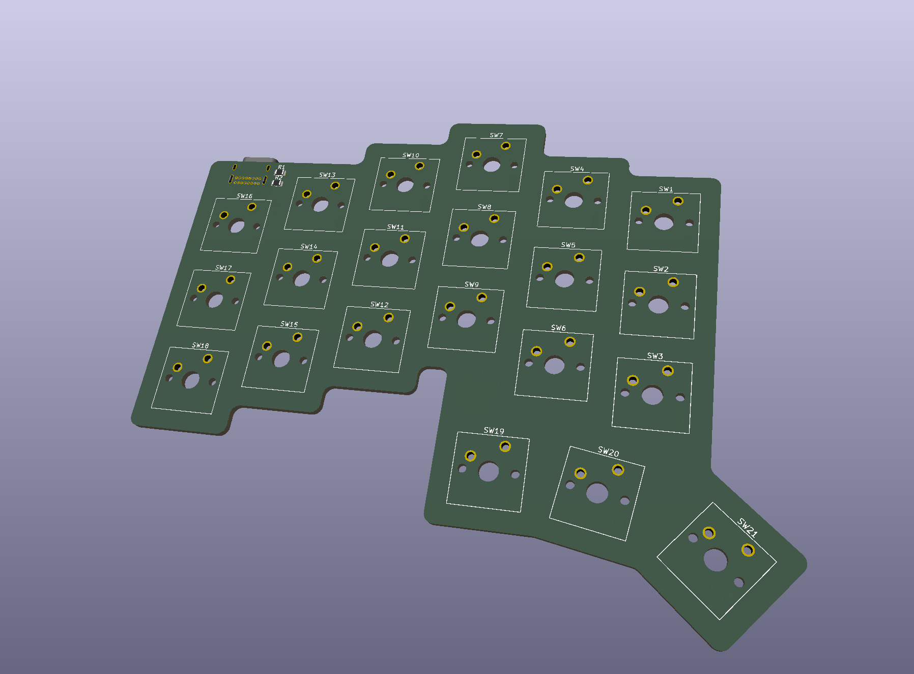
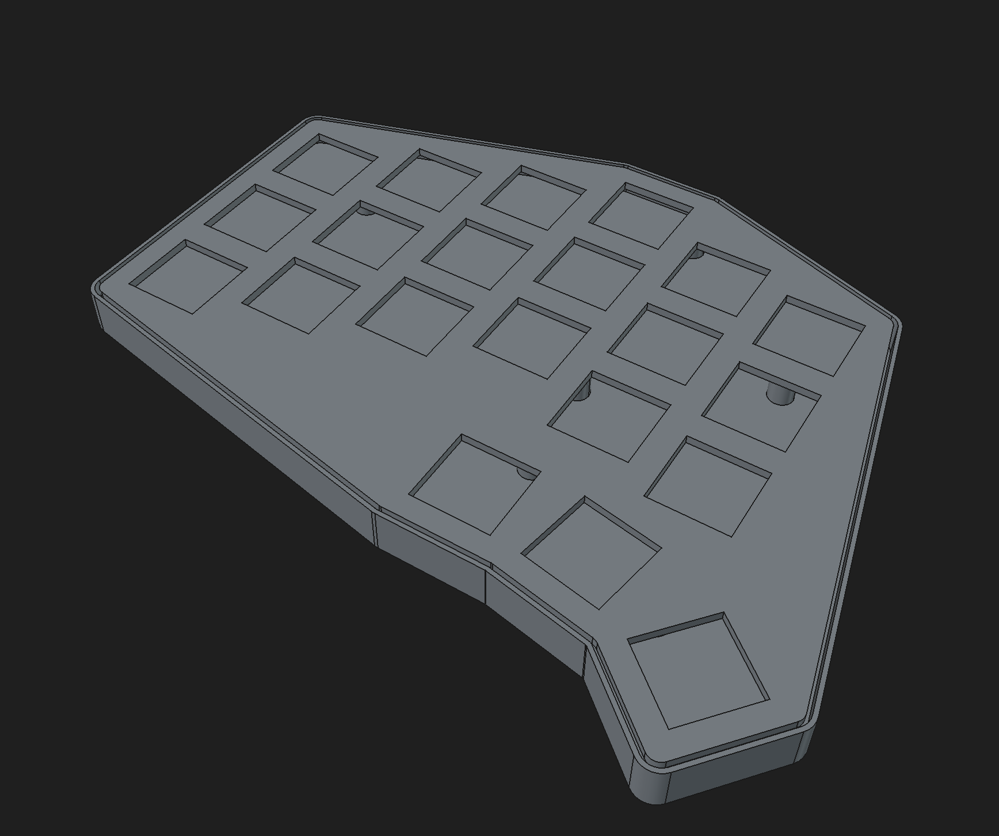

# Custom Keyboard

# 🚧 This is a work in progress 🚧

A custom mechanical keyboard deisgned and built from the ground up

## Features

- Custom PCB designed for the keyboard
- Custom case designed in CAD
- Custom firmware

## Design

### PCB

Designed from scratch in KICAD

### Case

Custom case designed in FreeCAD and 3D printed

## Firmware

Custom firmware the will be written in rust

## Folders

- 'firmware/' - Keyboard firmware
- 'pcb/' - PCB design files
- 'artifacts/' - STLs, DXFs, and other exported files
- 'screenshots/' - Screenshots of various parts during development
